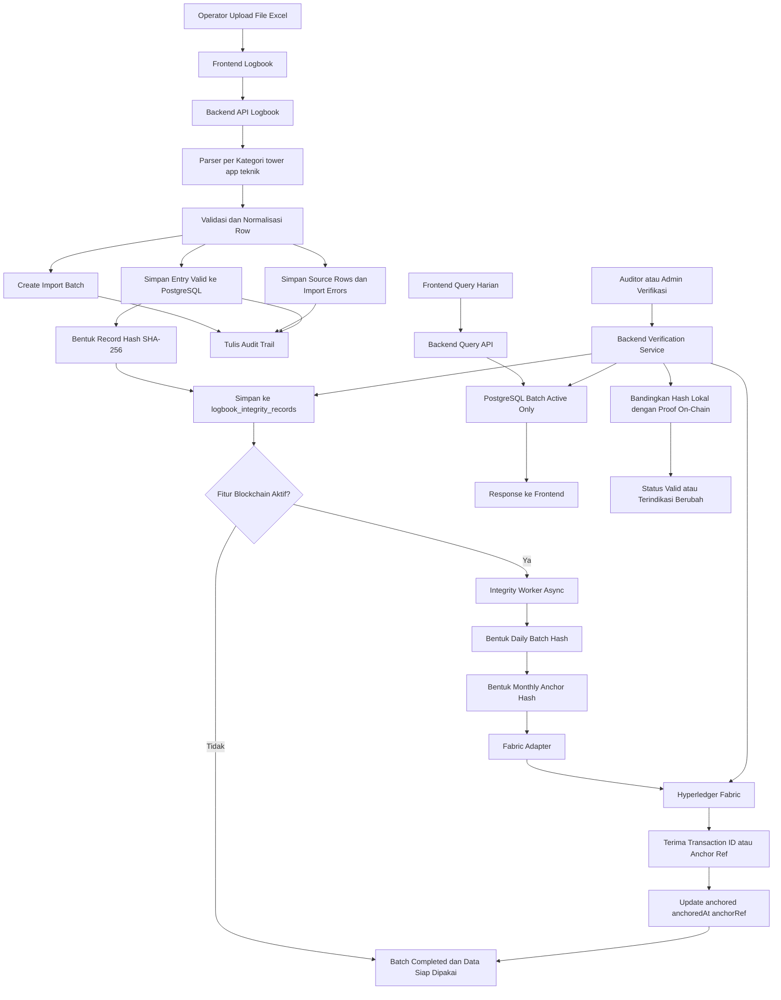

# Arsitektur Blockchain Logbook

## Tujuan

Dokumen ini menjelaskan posisi blockchain dalam arsitektur `Logbook` berdasarkan codebase aktif saat ini, bukan berdasarkan asumsi masa depan.

Tujuan utamanya:

- menjelaskan alur integrity yang sudah berjalan sekarang
- menjelaskan gap antara implementasi aktif dan target blockchain
- memberi rancangan tahapan implementasi blockchain yang aman
- menjaga agar PostgreSQL tetap menjadi source of truth operasional

## Ringkasan Singkat

Status saat ini:

- `Logbook` belum memiliki integrasi Hyperledger Fabric aktif
- backend saat ini baru membentuk `record hash` dan menyimpannya off-chain di PostgreSQL
- tabel `logbook_integrity_records` sudah menyiapkan field untuk status anchoring
- field `anchored`, `anchoredAt`, dan `anchorRef` belum diisi oleh adapter blockchain aktif

Kesimpulan arsitektur:

- data operasional tetap disimpan di PostgreSQL
- blockchain diposisikan sebagai `proof layer`
- blockchain tidak boleh menjadi jalur baca utama frontend atau API operasional

Model yang dipakai:

- `raw data off-chain`
- `proof on-chain`

## Kondisi Implementasi Saat Ini

Implementasi aktif yang relevan:

- import batch disimpan di `logbook_import_batches`
- source row mentah disimpan di `logbook_import_sources`
- error parsing disimpan di `logbook_import_errors`
- audit event disimpan di `logbook_audit_trails`
- integrity record disimpan di `logbook_integrity_records`

Pada saat import berhasil:

1. backend membuat batch import
2. backend mem-parsing file Excel per kategori
3. backend menyimpan source row dan error parsing
4. backend menyimpan record valid ke tabel entry kategori
5. backend membentuk `SHA-256` per record valid
6. backend menyimpan hash tersebut ke `logbook_integrity_records`
7. backend menulis audit trail import

Bagian pentingnya:

- hash dibentuk di `Logbook/backend/src/logbook/logbook.service.ts`
- hash yang dibentuk sekarang adalah `record-level hash`
- belum ada pembentukan `daily batch hash`
- belum ada pembentukan `monthly anchor hash`
- belum ada publisher job untuk mengirim hash ke Fabric

## Data Yang Sudah Siap Untuk Blockchain

Tabel `logbook_integrity_records` sudah menyediakan fondasi untuk integrasi blockchain.

Field yang relevan:

- `batchId`
- `recordType`
- `recordRef`
- `hashType`
- `hashValue`
- `anchored`
- `anchoredAt`
- `anchorRef`

Makna field dalam arsitektur target:

- `recordType`: jenis objek yang di-hash, misalnya `record`, `daily_batch`, atau `monthly_anchor`
- `recordRef`: referensi objek off-chain yang diverifikasi
- `hashType`: algoritma hash, saat ini `sha256`
- `hashValue`: hasil hash canonical data
- `anchored`: apakah hash ini sudah di-anchor ke blockchain
- `anchoredAt`: waktu anchor sukses
- `anchorRef`: referensi transaksi blockchain, misalnya transaction ID Fabric

Saat ini yang benar-benar aktif baru:

- `recordType = record`
- `hashType = sha256`
- `hashValue`

## Peran Blockchain Dalam Logbook

Blockchain tidak dipakai untuk:

- menyimpan isi Excel
- menyimpan isi lengkap entri logbook
- menyimpan payload error parsing
- menjadi database query harian
- menggantikan PostgreSQL

Blockchain dipakai untuk:

- menyimpan bukti integritas
- menyimpan hash agregat
- menyimpan referensi event penting
- menyimpan timestamp anchor
- menyimpan identitas transaksi pembuktian

Dengan pendekatan ini:

- sistem operasional tetap cepat
- biaya dan kompleksitas chain lebih terkendali
- verifikasi integritas tetap kuat

## Alur Blockchain Yang Direkomendasikan

Alur target yang aman untuk `Logbook` adalah sebagai berikut.

### 1. Import dan Hash Off-Chain

Saat operator mengunggah file:

1. file diproses oleh backend
2. data dinormalisasi ke tabel entry
3. backend membentuk `record hash`
4. hash disimpan di `logbook_integrity_records`
5. batch ditandai `completed`

Pada tahap ini sistem sudah punya integrity mirror off-chain, walau belum terhubung ke blockchain.

### 2. Agregasi Hash

Setelah batch selesai:

1. sistem mengambil semua `record hash` valid dalam satu unit agregasi
2. sistem membentuk `daily batch hash`
3. sistem membentuk `monthly anchor hash`
4. hash agregat juga disimpan di `logbook_integrity_records`

Mengapa agregasi dibutuhkan:

- anchoring per record terlalu mahal dan noisy
- unit audit operasional `Logbook` lebih cocok di level hari atau bulan
- rollback dan reimport lebih mudah ditelusuri bila anchor memakai unit periode

### 3. Anchor ke Blockchain

Worker asynchronous melakukan:

1. mengambil integrity record yang belum di-anchor
2. memilih hash agregat yang layak dipublikasikan
3. mengirim payload ringkas ke adapter Fabric
4. menerima `transaction id` atau reference proof
5. mengupdate `anchored = true`
6. mengisi `anchoredAt` dan `anchorRef`
7. mencatat audit trail anchor

### 4. Verifikasi Integritas

Saat auditor ingin memverifikasi:

1. sistem mengambil data off-chain yang menjadi objek verifikasi
2. sistem menghitung ulang hash canonical
3. sistem membaca `hashValue` lokal
4. bila perlu sistem membaca `anchorRef` dari blockchain
5. sistem membandingkan hasil perhitungan dengan hash yang pernah di-anchor

Jika cocok:

- data dianggap tidak berubah sejak titik anchor tersebut

Jika tidak cocok:

- ada indikasi perubahan data, perubahan canonicalization, atau ketidaksinkronan proses anchoring

## Tiga Level Hash Yang Paling Cocok

Untuk `Logbook`, model tiga level paling masuk akal adalah:

### 1. Record Hash

Isi:

- satu hash untuk satu entry hasil normalisasi

Tujuan:

- verifikasi granular
- mendeteksi perubahan pada satu entri

Status:

- sudah aktif di codebase saat ini

### 2. Daily Batch Hash

Isi:

- hash agregat dari semua `record hash` untuk satu tanggal operasional dalam kategori tertentu

Tujuan:

- verifikasi tingkat menengah
- memudahkan audit harian

Status:

- belum aktif
- cocok dijadikan tahap implementasi berikutnya

### 3. Monthly Anchor Hash

Isi:

- hash agregat dari seluruh `daily batch hash` pada satu periode bulanan

Tujuan:

- unit anchor utama ke Hyperledger Fabric
- efisien untuk bukti bulanan

Status:

- belum aktif
- paling cocok dijadikan payload default ke blockchain

## Kenapa Blockchain Tidak Boleh Langsung Di Jalur Utama

Jika controller atau query harian langsung bergantung ke Fabric, akan muncul masalah:

- latensi baca meningkat
- dependency eksternal bertambah untuk semua request
- kegagalan node blockchain bisa memengaruhi dashboard harian
- rollback dan reimport jadi lebih rumit

Karena itu prinsipnya harus tetap:

- frontend baca ke backend
- backend baca ke PostgreSQL
- blockchain hanya dipakai untuk proof, bukan read path utama

## Dampak Reimport dan Rollback Ke Blockchain

`Logbook` saat ini memakai model batch aktif dan archived.

Artinya:

- row lama tidak dihapus saat reimport
- batch lama hanya diarsipkan
- rollback hanya mengubah batch mana yang aktif

Implikasi ke blockchain:

- blockchain tidak perlu menghapus anchor lama
- anchor lama tetap valid sebagai bukti histori batch lama
- batch revisi harus membuat hash dan anchor baru
- rollback tidak mengubah histori chain, hanya mengubah state aktif off-chain

Ini penting karena blockchain bersifat append-only.

Model yang aman:

- setiap batch completed boleh punya proof sendiri
- state `active` tetap hidup off-chain
- blockchain menyimpan histori proof, bukan status query aktif

## Rancangan Komponen Yang Disarankan

Komponen tambahan yang sebaiknya dibuat saat implementasi blockchain dimulai:

- `backend/src/integrity/integrity.service.ts`
- `backend/src/integrity/hash-canonicalizer.ts`
- `backend/src/integrity/integrity-aggregator.ts`
- `backend/src/integrity/blockchain-adapter.interface.ts`
- `backend/src/integrity/fabric.adapter.ts`
- `backend/src/integrity/integrity-worker.ts`

Pembagian tanggung jawab:

- `integrity.service`: orchestration use case integrity
- `hash-canonicalizer`: canonical serialization sebelum hash
- `integrity-aggregator`: membentuk daily dan monthly hash
- `blockchain-adapter.interface`: boundary supaya domain tidak tergantung Fabric langsung
- `fabric.adapter`: implementasi koneksi Hyperledger Fabric
- `integrity-worker`: proses async anchor dan retry

## Payload Yang Sebaiknya Naik Ke Fabric

Payload minimal yang aman:

- `proofType`
- `sourceSystem`
- `category`
- `sourcePeriod`
- `batchId`
- `hashType`
- `hashValue`
- `anchoredAt`
- `actorId`

Contoh konsep payload:

```json
{
  "proofType": "monthly_anchor",
  "sourceSystem": "logbook",
  "category": "tower",
  "sourcePeriod": "2026-03",
  "batchId": "uuid-batch",
  "hashType": "sha256",
  "hashValue": "abc123...",
  "actorId": "user-sub",
  "anchoredAt": "2026-04-14T10:30:00Z"
}
```

Payload ini cukup untuk proof, tanpa membocorkan isi operasional.

## Tahapan Implementasi Yang Disarankan

Supaya realistis terhadap codebase aktif, urutannya sebaiknya:

### Tahap 1

- rapikan canonical hash untuk `record hash`
- pastikan semua hash dibentuk konsisten lintas kategori
- tambahkan dokumentasi dan endpoint inspeksi internal jika perlu

### Tahap 2

- implementasikan `daily batch hash`
- implementasikan `monthly anchor hash`
- simpan hasil agregasi ke `logbook_integrity_records`

### Tahap 3

- buat worker async untuk anchoring
- buat adapter Hyperledger Fabric
- update `anchored`, `anchoredAt`, `anchorRef`

### Tahap 4

- buat endpoint verifikasi integrity
- tampilkan status proof di UI admin atau `Import Center`
- tambahkan audit trail untuk proses verifikasi dan anchor failure

## Batasan Yang Harus Dijaga

Saat implementasi blockchain nanti, jangan melanggar batasan ini:

- jangan jadikan blockchain sebagai database utama
- jangan simpan payload mentah Excel ke chain
- jangan bypass filter `is_active` untuk query operasional
- jangan campur controller import dengan detail SDK Fabric
- jangan membuat kegagalan anchor memblokir seluruh import operator

Aturan operasional yang lebih aman:

- import tetap boleh sukses walau anchor job gagal
- status anchor ditandai terpisah dan bisa di-retry
- proof chain diperlakukan sebagai enhancement integrity, bukan syarat minimum query harian

## Kesimpulan

Arsitektur blockchain `Logbook` yang paling benar untuk codebase ini adalah:

- PostgreSQL tetap menjadi source of truth
- `logbook_integrity_records` menjadi mirror integritas off-chain
- Hyperledger Fabric dipakai untuk notarization hash agregat
- read path harian tidak boleh bergantung ke blockchain
- reimport dan rollback tetap dikelola di level batch off-chain
- histori proof di blockchain bersifat append-only dan tidak menggantikan state aktif

Dalam kondisi saat ini, fondasi blockchain sudah mulai ada di level schema dan hashing, tetapi integrasi chain-nya belum aktif. Jadi posisi yang jujur adalah:

- `integrity-ready`
- belum `blockchain-enabled`

## Flow Chart Mermaid

Diagram berikut menggambarkan alur target yang paling cocok untuk `Logbook`, sambil tetap menunjukkan batas antara flow aktif saat ini dan flow blockchain yang masih tahap pengembangan.



Catatan baca diagram:

- jalur `Operator Upload File Excel` sampai `Simpan ke logbook_integrity_records` adalah flow yang sebagian besar sudah aktif sekarang
- jalur `Integrity Worker Async` sampai `Hyperledger Fabric` adalah flow target blockchain yang belum aktif di codebase
- jalur query harian tetap hanya membaca PostgreSQL batch aktif
- blockchain tidak ikut di jalur baca operasional normal
